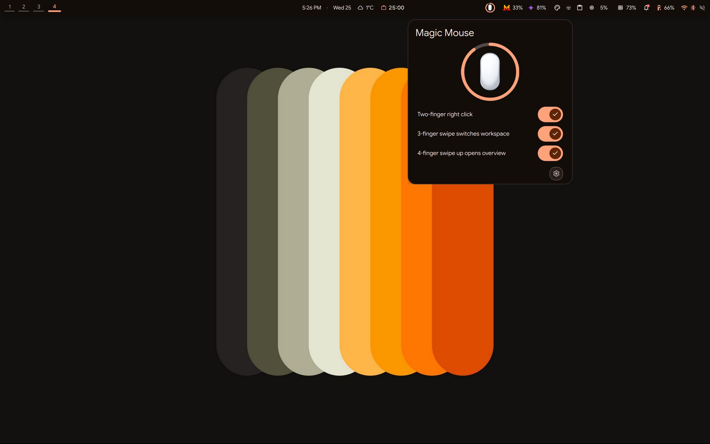
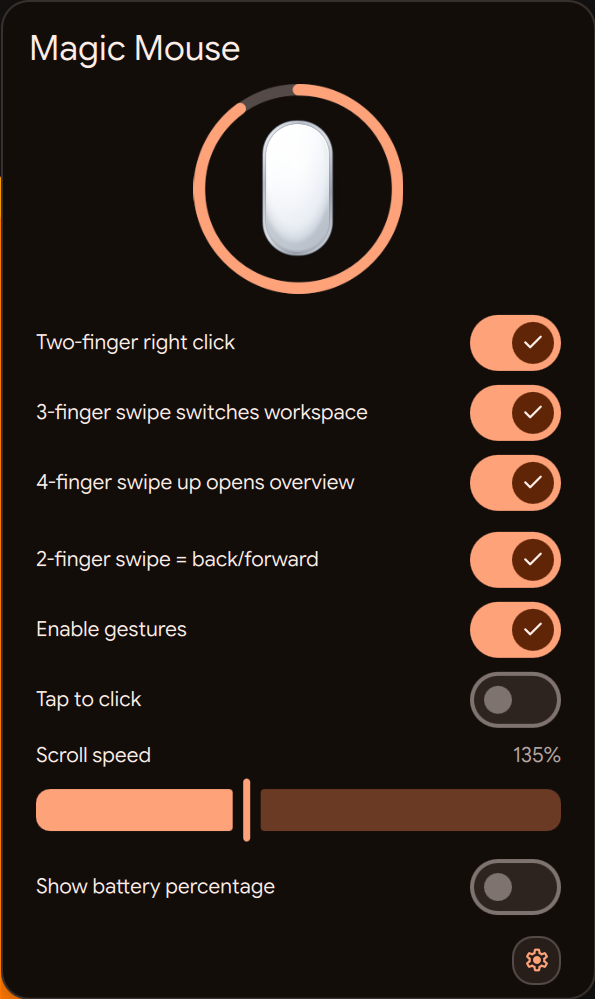

# dms-magic-options

A [Dux Modular Shell](https://github.com/duxlabs-dev/dux-shell) (DMS) plugin allowing a logi-options-esque control over the **Magic Mouse**.
It allows to finger right click, workplace swipe, left and right two finger swipes in the browser, and a 4-finger swipe for niri overview.

>[!Warning] Only tested with Magic Mouse 1
> Since i only own a Magic Mouse of the first generation, I could only test it with this.

What it adds
- granular control over your **Magic Mouse**-experience in DMS....
- A nice bar widget, showing current charge and giving you quick access to settings.
- Customizing scroll speed as you need it.

## Screenshots



Bar widget:


Popout controls:



## Install

```sh
git clone https://github.com/JonasNowak/dms-magic-options ~/.config/dms/plugins/magicOptions
```

Then in DMS: **Settings → Plugins → Scan**, enable **Magic Mouse Options**, add
the widget in **Settings → Bar widgets**, and restart the shell with `dms restart`.

## Requirements

- DMS 2.0.0 or newer
- `python3` (runs the gesture bridge)
- Read access to the mouse's evdev node (`/dev/input/event*`, `input` group) for gestures
- Write access to the mouse's hidraw node for button config, e.g. a udev rule:

  ```
  SUBSYSTEM=="hidraw", ATTRS{idVendor}=="05ac", ATTRS{idProduct}=="030d", MODE="0660", GROUP="input"
  ```

  Without it, `mouse-config.sh` falls back to `pkexec` for HID writes.

## How it works

- `MagicOptionsDaemon.qml` polls `mouse-config.sh status` every 30 s (battery via
  `/sys/class/power_supply/hid-*-battery-*`) and re-applies settings on startup
  and whenever plugin data changes.
- `mouse-config.sh` discovers the mouse (hidraw / evdev / power_supply by name),
  writes HID feature reports for the right-click mode, and starts/stops
  `gesture-bridge.py`.
- `input-bridge.py` grabs the mouse's evdev node and re-emits it through uinput
  (stdlib only), so it can map physical two-finger clicks (or optional two-finger
  taps) to `BTN_RIGHT`, optional one-finger taps to `BTN_LEFT`, scale wheel
  scroll speed (`MAGIC_SCROLL_SPEED`), map 2-finger horizontal swipes to `Alt+Left`
  / `Alt+Right`, map 3-finger horizontal swipes to
  `niri msg action focus-workspace-left/right`, and map 4-finger swipe up to
  `niri msg action toggle-overview`. The kernel `magicmouse` driver on Magic
  Mouse 1 only emits `BTN_LEFT`, so two-finger right-click is handled in userspace.

The HID feature-report payloads in `mouse-config.sh` follow the publicly
documented Magic Mouse 1 layout; if the device ignores a report, adjust the
`REPORT_*` table at the top of the script.

## Files

```
plugin.json               plugin manifest
MagicOptionsWidget.qml    bar pill (mouse + battery ring) and popout
MagicOptionsDaemon.qml    battery polling + apply on start/change
MagicOptionsSettings.qml  full settings page
StartupCheck.qml          dependency/permission check
mouse-config.sh           status + apply backend
input-bridge.py           evdev grab + uinput remap (buttons, gestures, wheel)
assets/magic-mouse.svg             top-down Apple Magic Mouse 1 artwork (popout)
assets/magic-mouse-icon.svg        compact bar widget iconogram
assets/screenshots/desktop.jpg     desktop view with bar widget and popout
assets/screenshots/bar-widget.png  bar widget with battery ring
assets/screenshots/popout.png      popout controls and scroll speed slider
```
